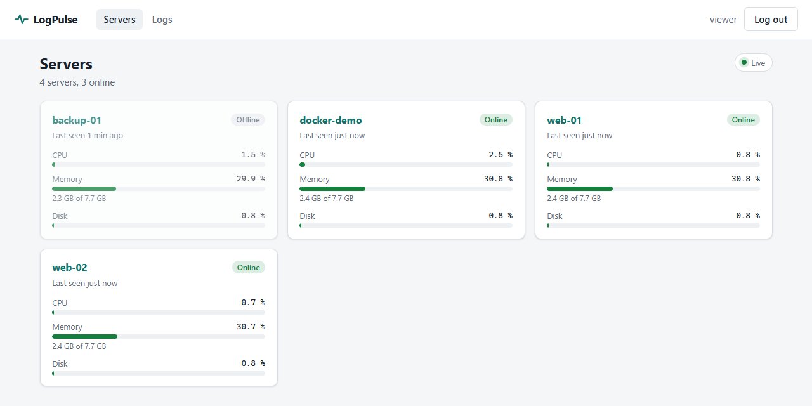
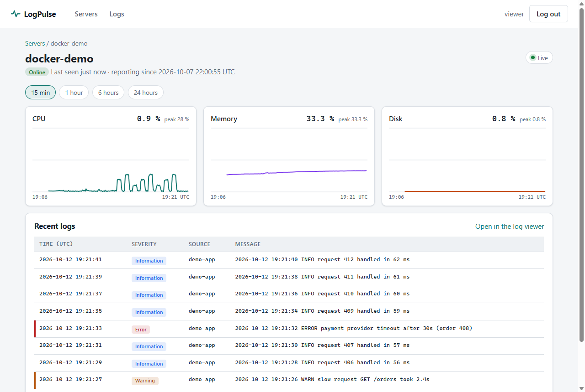
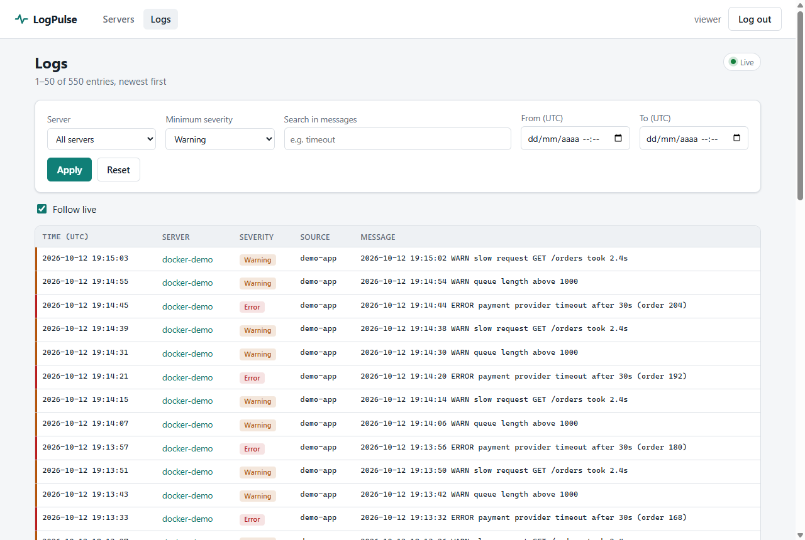
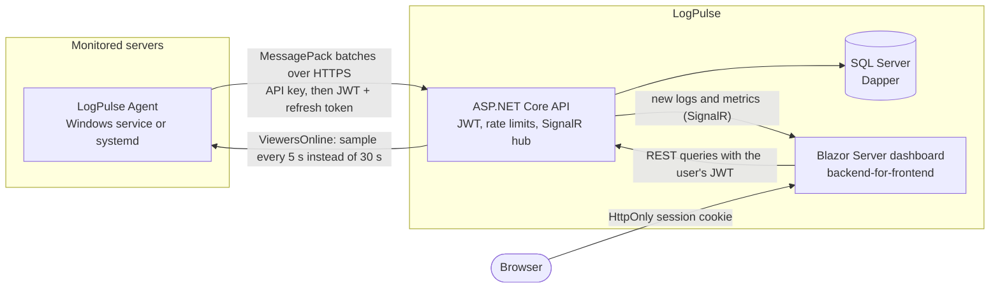

# LogPulse

[](https://github.com/Samot2003/logpulse/actions/workflows/ci.yml)
[](https://github.com/Samot2003/logpulse/actions/workflows/cd.yml)
[](global.json)
[](LICENSE)

Self-hosted server monitoring in C#/.NET 8. A lightweight agent collects metrics and logs on each server, an ASP.NET
Core API stores them in SQL Server, and a Blazor dashboard shows them live.



## Features

- **Agent** for Windows (service) and Linux (systemd). It samples CPU, memory and disk usage and follows log files
  like `tail -F`, surviving rotation and restarts. Data is sent in MessagePack batches, with retries.
- **API** with JWT access tokens, rotating refresh tokens and reuse detection, and role-based authorization. Rate
  limits per IP, agent and user. Ingestion in JSON or MessagePack, plus filtered and paged queries and a `/health` check.
- **Real-time dashboard**: a servers overview, charts per server and a log viewer with filters and "follow live",
  pushed over SignalR. Agents sample faster while someone is watching.
- **Runs anywhere**: one `docker compose up` locally, or Azure Container Apps + Azure SQL, deployed by the CD pipeline
  inside the free tiers.

| Server detail | Log viewer |
|---|---|
|  |  |

## Architecture



| Project | What it is |
|---|---|
| [`src/LogPulse.Core`](src/LogPulse.Core) | Models and contracts shared by every project |
| [`src/LogPulse.Data`](src/LogPulse.Data) | DAOs with Dapper behind interfaces, plus the SQL schema scripts |
| [`src/LogPulse.Api`](src/LogPulse.Api) | Web API: auth, ingestion, queries, live hub, retention |
| [`src/LogPulse.Agent`](src/LogPulse.Agent) | Worker service that runs on each monitored server |
| [`src/LogPulse.Dashboard`](src/LogPulse.Dashboard) | Blazor Server dashboard |
| [`tests/LogPulse.Tests`](tests/LogPulse.Tests) | xUnit unit tests, bUnit component tests, Testcontainers integration tests |
| [`infra/main.bicep`](infra/main.bicep) | Azure infrastructure |

## Quick start

Requires Docker:

```bash
cp .env.example .env
docker compose up --build
```

In about a minute, open <http://localhost:5090> and log in as `viewer` / `change-me-viewer-password`. Those are
the placeholder values from `.env.example`: they work locally, but change every value in `.env` before running the
stack anywhere but your own machine. A demo agent reports as `docker-demo`, and its logs arrive live from a generator
that writes a line every two seconds. See [docs/docker.md](docs/docker.md) for how
the stack is put together.

To build and test without Docker you need the .NET 8 SDK:

```bash
dotnet build LogPulse.sln
dotnet test LogPulse.sln --filter "Category!=Integration"   # unit tests
dotnet test LogPulse.sln --filter "Category=Integration"    # integration tests (start SQL Server with Docker)
```

## Design decisions

- **Dapper instead of EF Core.** The queries are few, and they are hot: log search with filters, multi-row bulk
  inserts, batched retention deletes. Writing the SQL by hand keeps them visible and tunable. The data access lives
  behind interfaces in `LogPulse.Data`, so the API never depends on Dapper.
- **Idempotent, numbered SQL scripts instead of migrations.** The API applies them at startup under an application
  lock (`sp_getapplock`), so several instances can start at the same time. Startup retries only the errors that mean
  "SQL Server is not ready yet"; a broken script fails at once.
- **MessagePack from the agent.** Batches of log lines are much smaller than in JSON. JSON stays available for
  humans and for testing.
- **Short-lived JWTs with rotating refresh tokens.** Access tokens last 15 minutes. Refresh tokens work once and are
  stored as SHA-256 hashes; reusing one revokes the whole session, because it means a token was stolen.
- **The dashboard is a backend-for-frontend.** Tokens never reach the browser: it only gets an encrypted
  `HttpOnly`, `SameSite=Strict` cookie with a session id. The dashboard server owns the token rotation.
- **At-least-once delivery from the agent.** The position in each log file is saved only after the API confirms the
  batch, so a crash resends lines rather than losing them. Bounded channels apply different policies: log lines wait
  when the buffer is full, metrics drop the oldest sample.
- **Adaptive sampling.** The API counts open dashboard connections and tells agents in every ingestion response
  whether anyone is watching. Agents sample every 5 s when someone is and every 30 s otherwise.
- **Defensive limits everywhere:** batch sizes and field lengths (truncated rather than rejected, so one long line
  does not drop a whole batch), query ranges, page numbers and rate limits. Behind a proxy, client IPs are taken from
  `X-Forwarded-For` only when it comes from a trusted address, so they cannot be spoofed.
- **Deployments that cannot surprise the owner.** CD signs in to Azure with OIDC (no stored password), only for an
  approved `production` environment. It deploys images by digest, and its role cannot read the apps' secrets.
  Everything is sized for free tiers: the database pauses instead of billing, and apps scale to zero.

## Quality and delivery

- **Tests:** 338: 276 unit and bUnit component tests that run in seconds, and 62 integration tests. The integration
  tests run the real API against SQL Server 2022 in Testcontainers, including the agent end to end.
- **CI** ([ci.yml](.github/workflows/ci.yml)) runs on every PR: formatting, a build with warnings as errors, unit and
  integration tests, merged coverage, a vulnerable-package check, Bicep validation, and the Docker images with a
  compose smoke test that waits for the demo agent's data. `main` only accepts PRs with all of them green.
- **CD** ([cd.yml](.github/workflows/cd.yml)) publishes the images to GHCR on every merge. Once Azure is set up
  ([docs/deploy-azure.md](docs/deploy-azure.md)), it deploys them after a manual approval and smoke tests `/health`.
  `v*` tags create a GitHub Release with the Windows agent.
- **Dependabot** keeps NuGet packages, GitHub Actions and base images up to date.

## Documentation

| Topic | |
|---|---|
| API endpoints, auth and rate limits | [docs/api.md](docs/api.md) |
| Agent configuration and installation (Windows service, systemd) | [docs/agent.md](docs/agent.md) |
| Dashboard pages and settings | [docs/dashboard.md](docs/dashboard.md) |
| Docker Compose stack | [docs/docker.md](docs/docker.md) |
| Deploying to Azure | [docs/deploy-azure.md](docs/deploy-azure.md) |
| How the project was built, milestone by milestone | [docs/ROADMAP.md](docs/ROADMAP.md) (in Spanish) |

## How this was built

LogPulse was built with [Claude Code](https://claude.com/claude-code) as an AI pair programmer. Claude Code wrote
most of the code; I set the scope and the milestones, made the design and deployment decisions, and reviewed and
approved every change. Each milestone went through quality gates before merging: specialised verification agents for
QA, code review, security, DevOps, API and UI testing, plus the same CI as any other change. The workflow is in the
repository: [CLAUDE.md](CLAUDE.md), [.claude/](.claude) and the milestone history in [docs/ROADMAP.md](docs/ROADMAP.md)
and [docs/verification/](docs/verification).

## License

[MIT](LICENSE)
